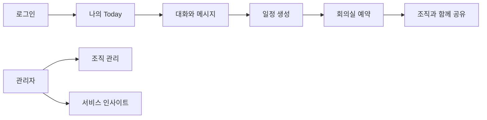
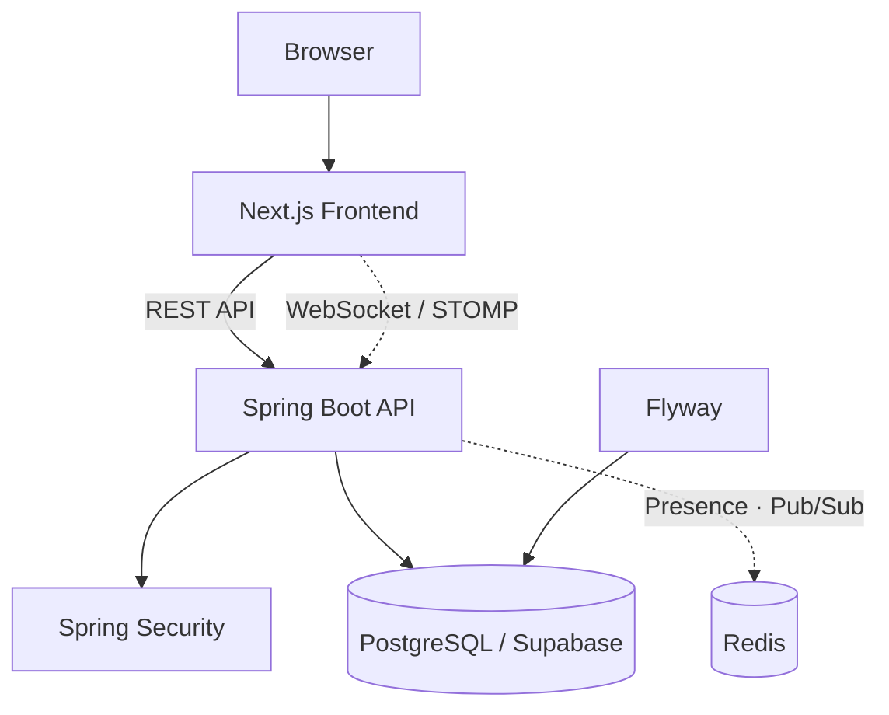
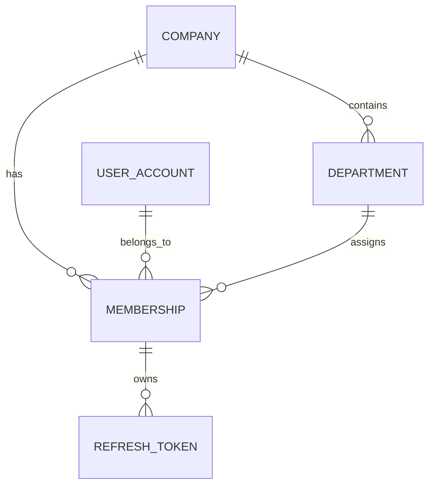

<div align="center">

# NaverWorks Clone

### 업무의 흐름을 연결하고, 협업의 신뢰도를 설계하는 Enterprise Collaboration Platform


`Backend Repository` · `Personal Portfolio Project`

</div>

---

## ✦ Project Story

메신저, 일정, 회의실, 조직 정보가 분리되어 있으면 구성원은 여러 도구 사이에서 맥락을 잃습니다.

**NaverWorks Clone**은 대화에서 시작된 업무가 일정과 회의실 예약으로 이어지고, 조직과 권한을 기준으로 안전하게 공유되는 협업 경험을 설계하는 프로젝트입니다. 이 저장소는 그 경험을 지탱하는 인증·권한·데이터 정합성·실시간 통신의 서버 기반을 담당합니다.

| Project Snapshot | Description |
| --- | --- |
| Product | 실시간 메신저와 일정·회의실 예약, 조직 권한을 통합하는 협업 플랫폼 |
| Core Value | 업무 맥락의 연결 · 조직 단위 데이터 격리 · 신뢰할 수 있는 실시간 경험 |
| Repository Role | API, 인증·인가, 도메인 규칙, 데이터 영속성, 실시간 통신 |
| Collaboration Model | Next.js Frontend와 Spring Boot API를 분리한 2개 저장소 구조 |

> 네이버웍스의 협업 경험을 참고하되, 특정 서비스의 내부 구현이나 디자인을 복제하지 않습니다.

---

## ✦ Experience We Build



| Experience | What it means |
| --- | --- |
| **Identity** | 사용자·회사·부서를 기반으로 누구인지, 무엇에 접근할 수 있는지 확인합니다. |
| **Conversation** | 1:1·그룹 메시지, 읽음 상태, 반응, 공지로 대화의 맥락을 보존합니다. |
| **Schedule** | 개인·조직 일정과 회의실 예약을 하나의 업무 흐름으로 연결합니다. |
| **Insight** | 일반 사용자에게는 Today를, 관리자에게는 조직 활동 인사이트를 제공합니다. |

---

## ✦ System Architecture



### Architectural Principles

| Principle | Design decision |
| --- | --- |
| Server owns authority | 프론트 UI가 아닌 서버의 인증·인가가 접근 제어의 근거가 됩니다. |
| Database is the source of truth | 메시지·예약 등 반드시 남아야 할 데이터는 RDBMS에 영속합니다. |
| Async delivery is not persistence | Redis Pub/Sub은 실시간 전파용이며, 유실 없는 저장을 대체하지 않습니다. |
| Schema evolves with code | Flyway 마이그레이션으로 DB 구조도 코드 이력처럼 관리합니다. |
| Scale only when needed | MSA·Kafka·Kubernetes는 초기 도입하지 않고, 문제 재현 후 선택합니다. |

---

## ✦ Technical Highlights

### 01. Organization-aware Identity & Access



- 회사 단위 멤버십을 기준으로 데이터 접근 범위를 제한합니다.
- 초기 역할은 `USER`, `ADMIN`으로 시작하고, 채팅방 역할·부서 관리자 등은 필요한 시점에 확장합니다.
- Refresh Token 원문을 DB에 남기지 않고 해시 기반으로 저장·폐기·회전을 설계합니다.

### 02. Reliable Real-time Messaging

- 메시지 원본은 DB에 저장하고, WebSocket/STOMP는 실시간 전달에 사용합니다.
- 사용자별 마지막 읽은 위치를 기반으로 읽지 않은 메시지 수를 계산하는 모델을 검토합니다.
- 대량 히스토리 조회는 Cursor Pagination과 `(room_id, id)` 인덱스의 실제 실행 계획을 비교합니다.

### 03. Conflict-free Meeting Room Reservation

- 예약 구간은 `[start, end)` 기준으로 해석하고, 겹침 조건을 명확히 검증합니다.
- 단순 `exists() → save()` 경쟁 조건을 재현한 뒤 낙관적 락·비관적 락·DB 제약을 비교합니다.
- 동시 요청에서 중복 예약 0건을 검증 기준으로 삼습니다.

### 04. Observable Engineering

- API latency, error rate, JVM, HikariCP, Redis, WebSocket 지표를 관찰 가능한 형태로 확장합니다.
- 문제를 추측으로 해결하지 않고, SQL·로그·부하 테스트·p95/p99를 근거로 판단합니다.
- 외부 LLM 요약 기능은 timeout, retry, fallback, rate limit을 포함해 격리합니다.

---

## ✦ Tech Stack

| Layer | Technology | Why |
| --- | --- | --- |
| Language | Java 21 | 안정적인 LTS 기반과 현대 Java 문법 활용 |
| Framework | Spring Boot 4.1.1, Spring MVC | 계층형 API와 Spring 생태계 기반의 확장성 |
| Security | Spring Security, JWT | Stateless API 인증과 서버 중심 인가 설계 |
| Persistence | Spring Data JPA, Hibernate | 도메인 모델·트랜잭션·실행 SQL을 함께 학습 |
| Database | PostgreSQL on Supabase | 관계형 정합성과 관리형 개발 환경 |
| Migration | Flyway | 애플리케이션과 DB 스키마의 동시 버전 관리 |
| Test | JUnit 5, Spring Boot Test | 인증·스키마·도메인 규칙 검증 |
| Future | Redis, WebSocket/STOMP, Nginx | 실시간 전달과 Scale-out 실험 |

---

## ✦ Portfolio Deep Dive

이 프로젝트의 핵심은 “기능 구현”보다 **문제를 재현하고 선택을 증명하는 과정**입니다.

| Question | Experiment | Evidence |
| --- | --- | --- |
| N+1은 언제 발생하는가? | LAZY 조회·Fetch Join·DTO Projection 비교 | 실행 SQL, 쿼리 수, 응답 시간 |
| OFFSET은 왜 느려지는가? | 대량 메시지에서 OFFSET과 Cursor 비교 | EXPLAIN, p95/p99 |
| `@Transactional`만으로 예약 경쟁을 막을 수 있는가? | 동일 시간대 동시 예약 재현 | 중복 예약 수, 락 대기 |
| 서버가 2대면 로컬 메모리 이벤트는 어떻게 되는가? | 교차 서버 접속 환경에서 전파 누락 재현 | 전달 결과, Redis Pub/Sub 비교 |
| 온라인 상태는 얼마나 정확한가? | 다중 탭·강제 종료·늦은 disconnect 검증 | TTL 만료·상태 전이 로그 |

측정 전에는 성과를 선언하지 않습니다. 실험의 환경·데이터·한계까지 기록해 재현 가능한 포트폴리오로 발전시킵니다.

---

## ✦ Local Setup

### Prerequisites

- JDK 21
- Supabase PostgreSQL 또는 호환 PostgreSQL

### Run API

`src/main/resources/application-local.yml.example`을 참고해 Git에서 제외되는 `application-local.yml`을 준비합니다.

```powershell
$env:SPRING_PROFILES_ACTIVE = "local"
.\mvnw.cmd spring-boot:run
```

### Test

```powershell
.\mvnw.cmd test
```

> 실제 DB 비밀번호와 JWT 시크릿은 Git에 올리지 않습니다. 테스트 프로필은 빠른 검증용 H2를 사용하고, 개발 DB는 Supabase PostgreSQL을 사용합니다.

---

## ✦ Project Status

프로젝트 기반으로 PostgreSQL(Supabase)·Flyway·JPA·JWT 검증 설정과 초기 조직 모델을 구성했습니다. 다음 구현 단위는 실제 로그인·토큰 갱신·로그아웃 API와 프론트 인증 연동입니다.

전체 제품 설계, 기능 체크리스트, 실험 명세는 아래 문서에서 확인할 수 있습니다.

- [Full Project Context](docs/PROJECT_CONTEXT.md)
- [Feature Checklist](docs/FEATURE_CHECKLIST.md)
- [Engineering Experiments](docs/ENGINEERING_EXPERIMENTS.md)
