<div align="center">

# NaverWorks Clone · Backend

### 실시간 메신저 · 조직 기반 권한 · 일정과 회의실 예약을 하나의 흐름으로 잇는 협업 플랫폼의 서버


`Backend Repository` · `Personal Portfolio Project` · [Frontend Repository →](https://github.com/wjsgusdn12/naverworks_clone_front)

</div>

> 네이버웍스의 협업 기능을 참고해 설계한 개인 프로젝트입니다. 특정 서비스의 내부 구현이나 디자인을 복제하지 않습니다.
> 이 문서는 프로젝트의 **전체 설계**를 그림으로 보여 줍니다.

---

## 1. 전체 구조

브라우저는 Next.js 화면과 대화하고, 화면은 REST와 WebSocket 두 통로로 이 서버와 대화합니다. 메시지·예약처럼 남아야 하는 데이터는 PostgreSQL에, 실시간 전파와 접속 상태처럼 흘러가는 데이터는 Redis에 둡니다.

<!-- diagram: architecture -->
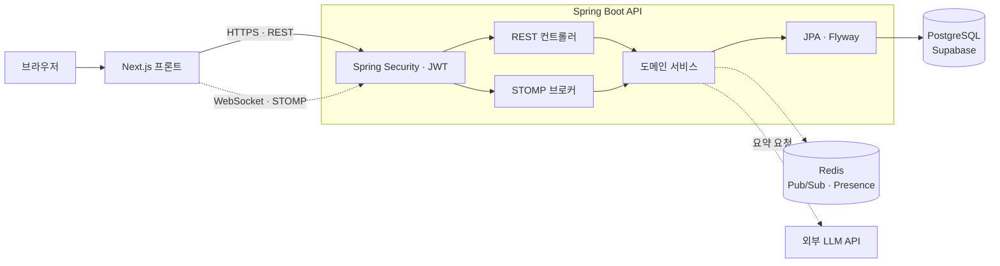

---

## 2. 배포 구조

비용 0원을 원칙으로 잡았습니다. 상시 가동이 필요한 서버 묶음은 Oracle 무료 VM 한 대에 docker-compose로 올리고, 프론트와 DB는 관리형 무료 서비스를 씁니다.

<!-- diagram: deployment -->
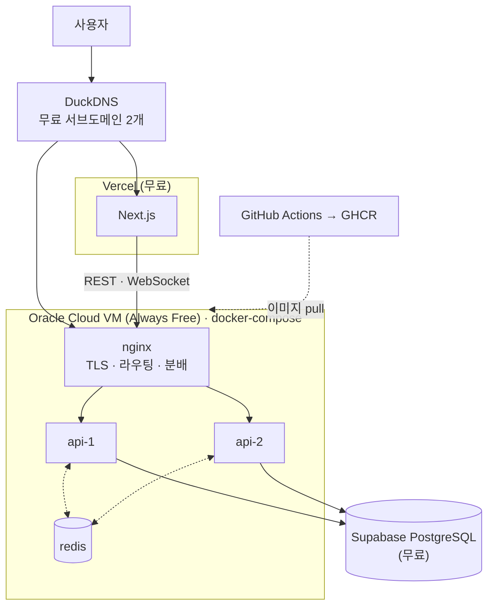

nginx가 인증서와 WebSocket 업그레이드를 맡고, 같은 이미지로 뜬 api 두 대 사이는 Redis가 이어 줍니다. Supabase의 7일 무활동 정지는 서버의 일일 keep-alive와 GitHub Actions 스케줄로 막습니다.

---

## 3. 도메인 지도

메신저가 중심이고, 조직·인증과 일정·예약이 나머지 두 축입니다. 운영 관점의 관측성과 AI 요약은 그 위에 얹는 층입니다.

<!-- diagram: domain-map -->
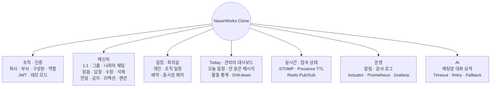

프로젝트·태스크 관리, MSA, Kafka, Kubernetes는 의도적으로 범위에서 뺐습니다. 문제가 재현되기 전에는 도입하지 않습니다.

---

## 4. 데이터 모델

회사 → 부서 → 구성원의 조직 계층이 모든 데이터의 울타리입니다. 메시지는 채팅방에, 읽음 위치는 참여자 행에, 부가 정보(멘션·리액션·공지)는 별도 테이블에 둡니다.

<!-- diagram: erd -->
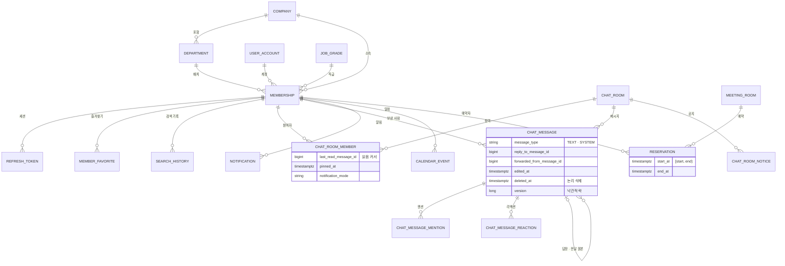

삭제는 전부 논리 삭제입니다.

---

## 5. 인증과 세션

Access Token은 3시간, Refresh Token은 최초 로그인 기준 최대 7일입니다. Refresh는 회전하지만 세션의 절대 만료 시각은 늘어나지 않아, 한 번 로그인하면 7일 뒤에는 반드시 다시 로그인합니다.

<!-- diagram: auth-flow -->
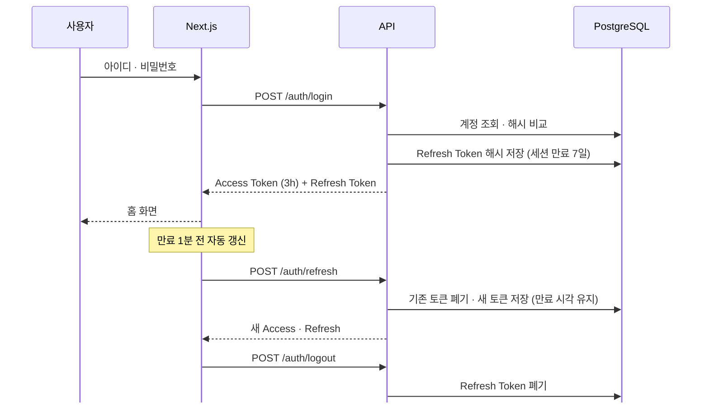

토큰 원문은 DB에 남기지 않고 해시만 저장합니다. 화면의 메뉴 숨김은 UX일 뿐이고, 권한 판단은 항상 서버의 `ROLE_USER` · `ROLE_ADMIN` 검사가 근거입니다.

---

## 6. 메시지 전송과 실시간 전파

메시지는 먼저 DB에 저장되고, 트랜잭션이 커밋된 뒤에만 실시간 이벤트가 나갑니다. 그래서 받는 쪽이 이벤트를 보고 조회해도 데이터가 없는 경우가 생기지 않습니다.

<!-- diagram: message-flow -->
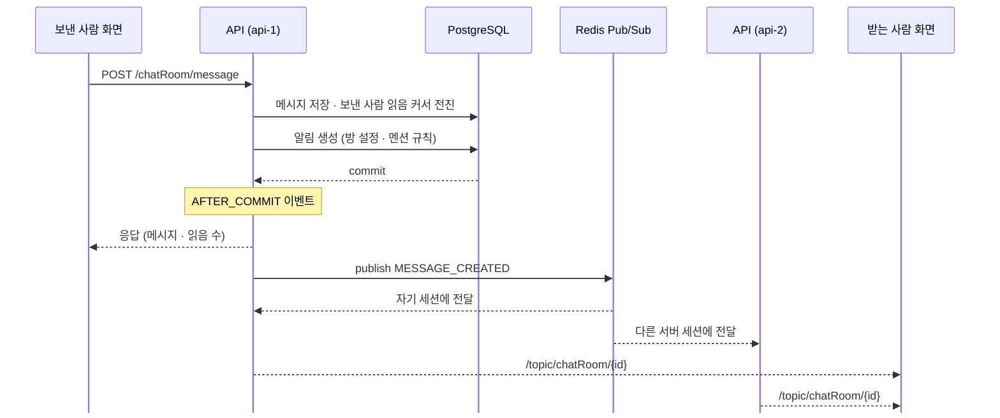

한 대로 돌 때는 Redis 없이 서버 안 브로커가 같은 역할을 합니다. 이벤트 종류는 MESSAGE_CREATED · UPDATED · DELETED · REACTION_UPDATED · NOTICE_UPDATED · READ_UPDATED · TYPING_CHANGED입니다.

---

## 7. 읽음 수 계산

메시지마다 "누가 읽었는지"를 저장하지 않습니다. 참여자마다 마지막으로 읽은 메시지 ID 하나만 두고, 읽음 수는 그 커서들로 계산합니다. 저장은 가볍고 계산은 쿼리 한 번입니다.

<!-- diagram: read-cursor -->
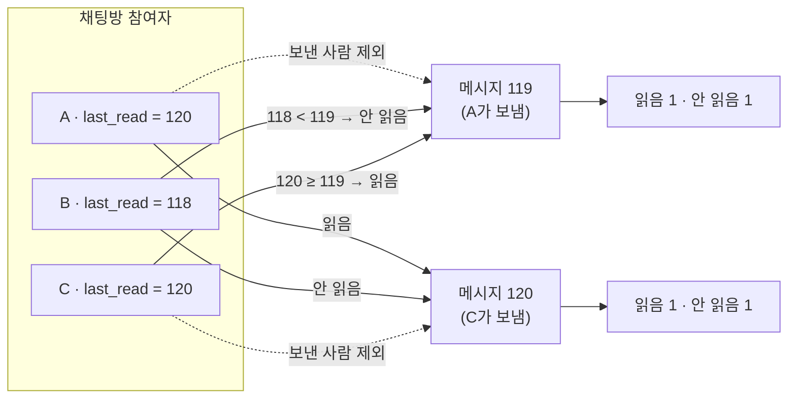

화면도 같은 규칙으로 계산합니다. 서버가 보내는 READ_UPDATED 이벤트는 "누가 어디까지"만 담고, 말풍선의 숫자는 화면이 커서로 다시 셉니다. 이벤트 순서가 뒤바뀌어도 숫자가 어긋나지 않습니다.

---

## 8. 메시지 확장 기능 규칙

답장·수정·삭제·전달·공지·리액션은 모두 같은 원칙을 따릅니다. 원본은 보존하고, 시간 제한은 24시간, 권한은 서버가 확인합니다.

<!-- diagram: message-rules -->
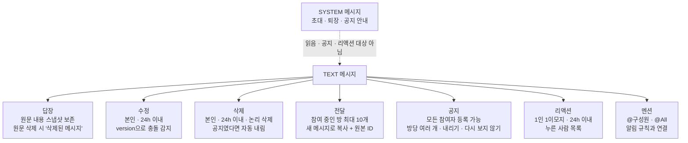

---

## 9. 접속 상태 (Presence)

온라인 여부는 서버 메모리가 아니라 Redis의 TTL 키로 판단합니다. 비정상 종료로 disconnect가 오지 않아도 TTL이 만료되면 저절로 오프라인이 됩니다.

<!-- diagram: presence -->
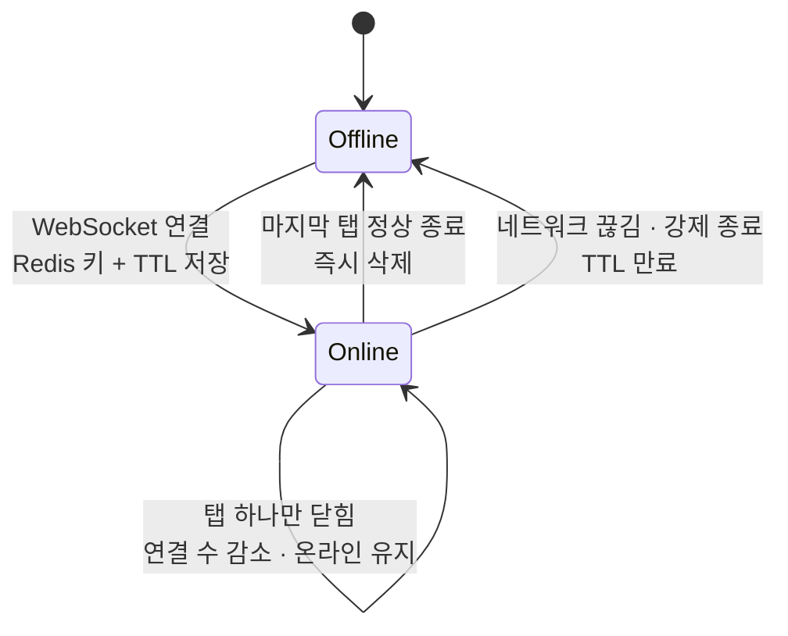

TTL 때문에 오프라인 감지에는 약간의 지연이 있습니다. "즉시 정확한 상태"가 아니라 "근사한 상태"라고 표현합니다.

---

## 10. 서버 2대와 Scale-out

같은 코드로 인스턴스 2개를 띄우고 nginx가 나눠 받습니다. 서버 메모리 안 브로커만 쓰면 다른 서버에 붙은 사용자에게 이벤트가 가지 않는다는 한계를 재현한 뒤, Redis Pub/Sub으로 잇습니다.

<!-- diagram: scale-out -->
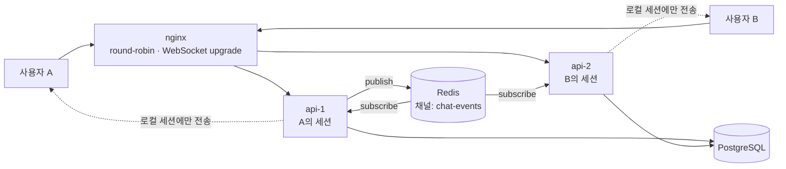

Pub/Sub은 저장하지 않습니다. 구독이 끊긴 동안의 이벤트는 사라지므로, 재연결한 화면은 DB에서 다시 조회해 메워야 합니다. 그 한계까지 문서에 남깁니다.

---

## 11. 회의실 예약과 동시성

같은 회의실의 시간이 겹치는 예약은 허용하지 않습니다. 구간은 `[start, end)`로 해석하고, 겹침은 `기존 시작 < 새 종료 AND 기존 종료 > 새 시작`으로 판정합니다.

<!-- diagram: reservation -->
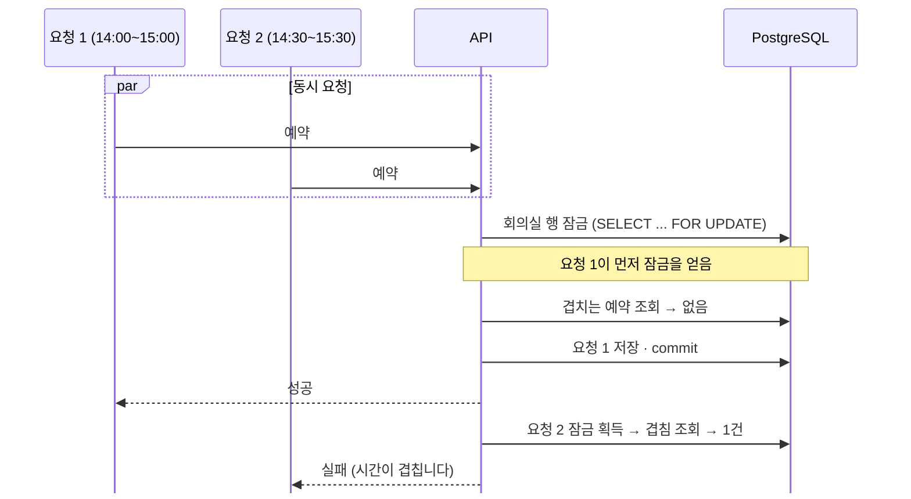

`@Transactional`만으로는 직렬화되지 않는다는 것을 동시 요청 100건으로 재현하고, 비관적 락·낙관적 락·DB 제약을 같은 조건에서 비교해 중복 0건을 확인하는 것이 이 단계의 목표입니다.

---

## 12. 관측성

운영 지표(서버 상태)와 서비스 통계(관리자 대시보드)를 분리합니다. 서버 상태는 Grafana에서 보고, 서비스 활동은 앱 안의 관리자 화면에서 봅니다.

<!-- diagram: observability -->
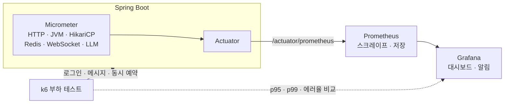

측정하지 않은 수치는 적지 않습니다. 실험은 같은 환경·데이터·부하 조건에서 Before와 After를 비교하고, 한계까지 기록합니다.

---

## 13. AI 대화 요약

채팅방 참여자만 자기 방의 메시지 범위를 요약할 수 있습니다. 외부 LLM이 느리거나 실패해도 채팅 자체는 영향을 받지 않도록 격리합니다.

<!-- diagram: ai-summary -->
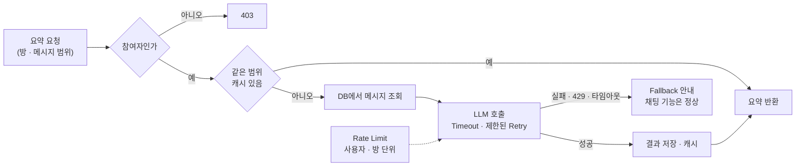

API 키는 서버 환경변수에만 둡니다. 외부로 나가는 대화 내용은 테스트 데이터 기준으로 다루고, 비용과 토큰 수를 지표로 남깁니다.

---

## 14. 패키지 구조

도메인별 패키지 안에 컨트롤러·서비스·도메인·리포지토리를 함께 둡니다. 공통 응답·예외·보안은 `common`, 설정은 `config`에 모읍니다.

<!-- diagram: packages -->
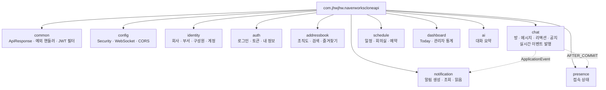

서비스는 ApplicationEvent로 느슨하게 연결합니다. 메시지 서비스가 알림 서비스를 직접 호출하지 않고 이벤트를 던지면, 알림·실시간 발행이 각자 구독해 처리합니다.

---

## 15. 개발 로드맵

짧은 수직 슬라이스(화면 ↔ API ↔ DB ↔ 테스트) 단위로 한 단계를 끝내고 다음으로 갑니다.

<!-- diagram: roadmap -->
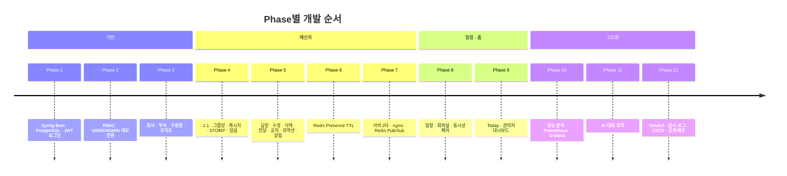

---

## 기술 스택

| 분류 | 선택 | 이유 |
| --- | --- | --- |
| 언어 · 프레임워크 | Java 21 · Spring Boot 4.1 · Spring MVC | LTS 기반, REST · Security · JPA · WebSocket을 한 생태계에서 |
| 인증 | Spring Security · JWT (Access 3h · Refresh 7d 회전) | Stateless API와 서버 중심 인가 |
| 영속성 | Spring Data JPA · Hibernate · Flyway | 도메인 모델과 스키마 이력을 코드와 함께 관리 |
| 데이터베이스 | PostgreSQL (Supabase) | 관계형 정합성과 관리형 무료 환경 |
| 실시간 | WebSocket · STOMP · Redis Pub/Sub | 양방향 이벤트와 서버 간 전파 |
| 접속 상태 | Redis TTL · Heartbeat | 비정상 종료에도 자동 정리 |
| 테스트 | JUnit 5 · Spring Boot Test · H2 | 도메인 규칙을 통합 테스트로 고정 |
| 관측 | Actuator · Micrometer · Prometheus · Grafana · k6 | 측정 근거 기반 개선 |
| 배포 | Docker Compose · nginx · Oracle Cloud · GitHub Actions · GHCR | 비용 0원 상시 가동 |

## 로컬 실행

```powershell
# src/main/resources/application-local.yml.example 을 복사해 application-local.yml 작성 (Git 제외)
$env:SPRING_PROFILES_ACTIVE = "local"
.\mvnw.cmd spring-boot:run

# 테스트
.\mvnw.cmd test
```

DB 비밀번호와 JWT 시크릿은 환경변수나 로컬 설정 파일에만 둡니다. 테스트 프로필은 H2를 씁니다.

## 문서

- [프론트엔드 README](https://github.com/wjsgusdn12/naverworks_clone_front#readme)
- 이 README의 다이어그램은 `scripts/build-diagrams.mjs`가 `docs/diagrams/`에 SVG로 뽑아 두며, 프론트 앱의 "프로젝트 소개" 모달이 같은 파일을 보여 줍니다.
